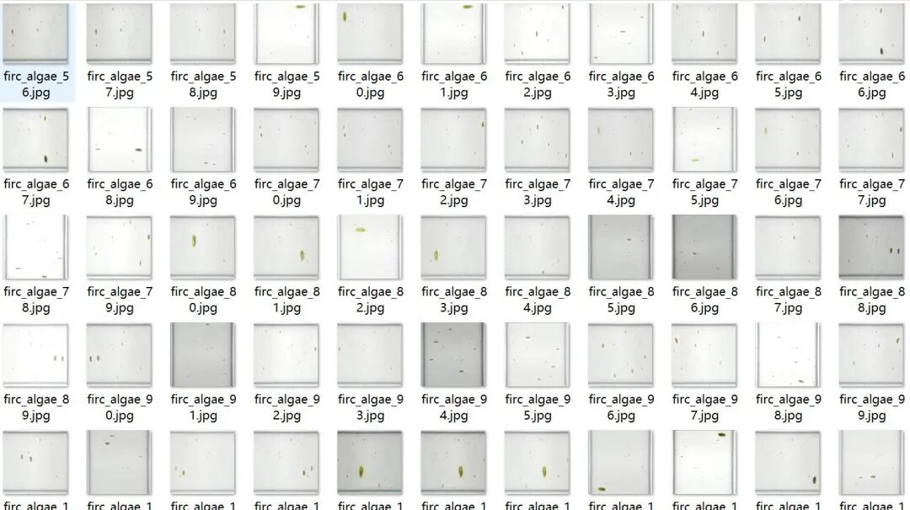
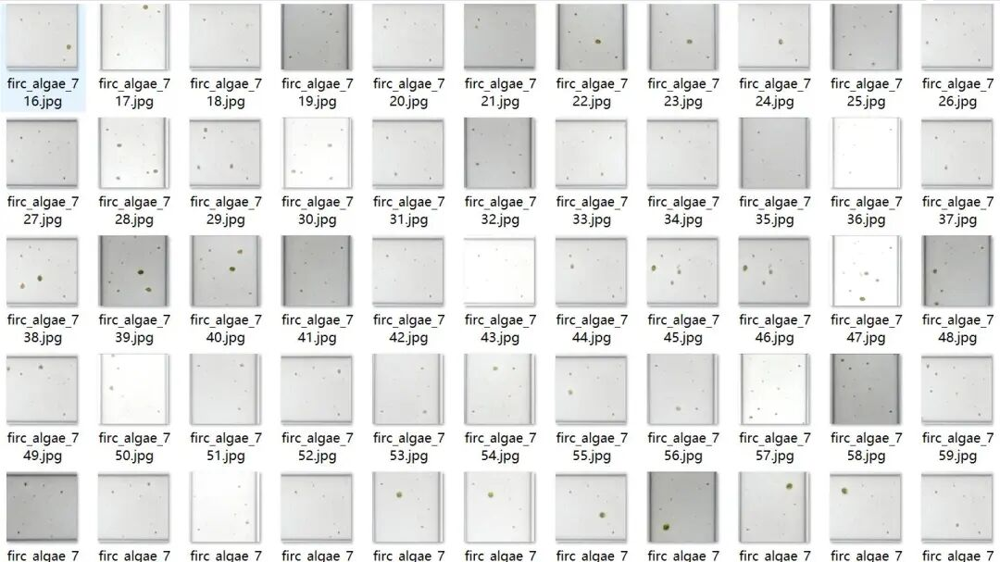
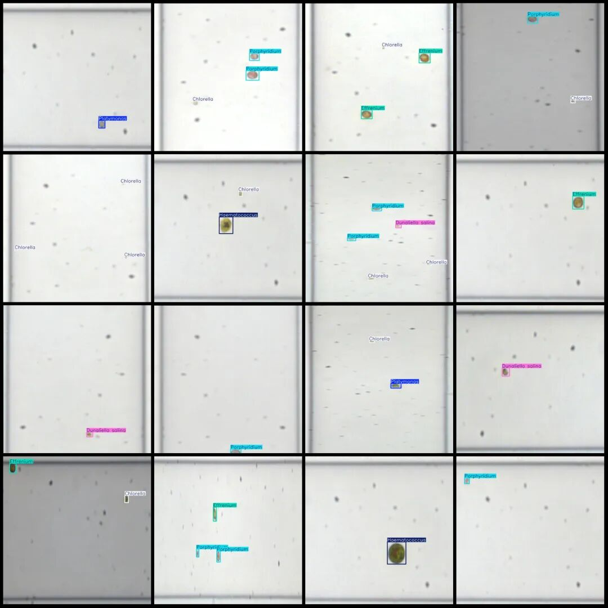

# High-throughput seaweed cell detection dataset VOC+YOLO format with 1690 images in 6 categories

Dataset format: Pascal VOC format + YOLO format (txt file without split path, only contains jpg images and corresponding VOC format xml files and yolo format txt files)

Number of images (number of jpg files): 1690

Number of annotations (number of xml files): 1690

Number of annotations (number of txt files): 1690

Label count: 6

Label category names (note that the order of categories in the Yolo format does not correspond to this, but is based on the labels folder's classes.txt): ["Chlorella", "Dunaliella salina", "Effrenium", "Haematococcus", "Platymonas", "Porphyridium"]

Number of boxes labeled in each category:

Chlorella (Microcystis) frame count = 1698

Dunaliella salina (Dunaliella salina) Frame count = 568

Effrenium (Evlenia) frame count = 557

Haematococcus (Chlorella) Frame count = 301

Platymonas (Platymonas) Frames = 458

Porphyridium (Zoochlorella) Frame count = 650

Total frame count: 4232

Using labelImg:

Annotation rules: Draw a rectangle around the category.

Image resolution: 640x640

Is the dataset enhanced? Yes, about 700 are original images and the rest are enhanced.

Important Notice: No

Special : This dataset does not guarantee the accuracy of the trained models or weight files.

Image Preview:

Annotation example:

## Payment

Here is a pay link on Stripe ( https://buy.stripe.com/3cs8yP7sY87d0vu9AB ). Please contact me lonlonago@foxmail.com after funding $89, and I will send you a complete data files , thank you!

